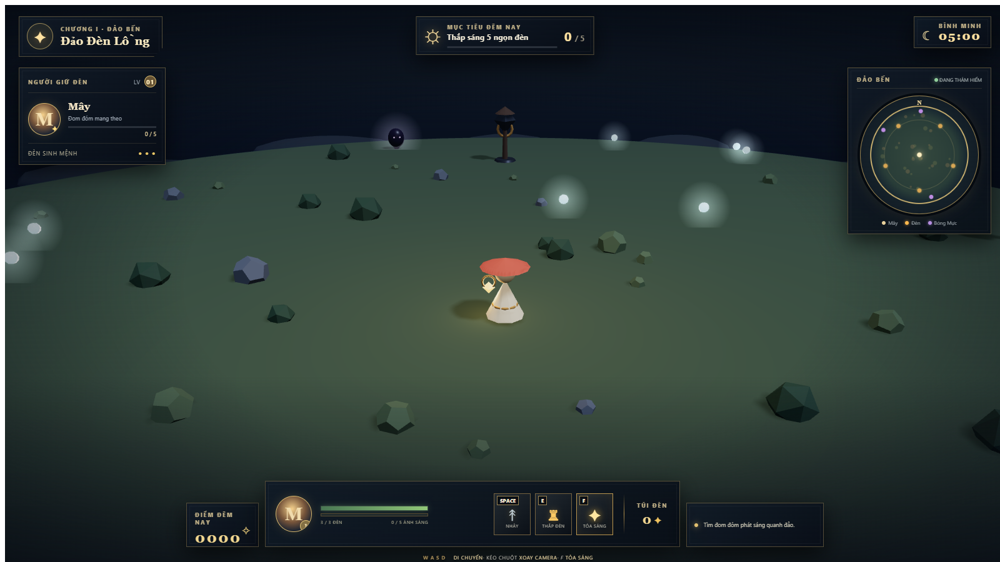

# Đảo Đèn Lồng · v1.0.0

Game sinh tồn 3D góc nhìn sau lưng Mây, xây bằng React, Three.js và Node.js. Giữ ít nhất 60% đèn còn sáng đến bình minh qua ba đêm; bóng mực hút dầu, Mây phải châm lại đèn và quản lý ngọn lửa.



## Yêu cầu

- Node.js 20.19 trở lên.
- Chrome hoặc Edge có WebGL để chơi; Chrome/Edge cần cho benchmark tự động.
- Windows, macOS hoặc Linux; desktop 1280×720 trở lên được khuyến nghị.

## Cài đặt và chạy

Clone repo, sau đó chạy ba lệnh:

```sh
npm install
npm run build
npm start
```

Mở `http://localhost:4173`. Bảng điểm được lưu cục bộ trong `data/leaderboard.json`; file này không được đưa lên Git.

Khi phát triển, `npm run dev` khởi động Vite và API local cùng lúc.

## Điều khiển

- Mặc định: `W A S D` di chuyển, `Space` nhảy, `Shift` lướt, `E` thắp/châm dầu, `F` Tỏa Sáng, `Esc` tạm dừng.
- Kéo chuột để xoay camera; lăn chuột để đổi khoảng cách.
- Vào **Cài đặt** để đổi từng phím. Phím trùng bị từ chối; có nút khôi phục mặc định. Tùy chọn màu dễ phân biệt, giảm chuyển động và chữ lớn cũng được lưu.
- Bảng xếp hạng lưu 10 chiến dịch tốt nhất trên máy này. Tên dùng 3–12 ký tự ASCII chữ/số/`_`.

## Kiểm tra và đo

```sh
npm run verify
node src/headless.js --seed 23 --night 2 --ticks 16200 --snapshot-every 60 --out run.jsonl
npm run bench -- --seed 42 --duration 30 --out bench.json
npm run soak -- --seed 7 --nights 10 --out soak.json
node server.js --export-leaderboard out.json
```

`npm run verify` chạy bộ kiểm tra Phase 4 và hồi quy Phase 1–3. Benchmark mở cửa sổ Chrome/Edge 1280×720, không fullscreen; dùng `--disable-frame-rate-limit` và `--disable-gpu-vsync` để tắt vsync trên Chromium. Ba giây đầu không tính vào FPS. `peak_mem_mb` là `null` vì trang web không đo RSS của toàn bộ cây tiến trình trình duyệt; renderer và hệ điều hành vẫn được ghi vào JSON.

Soak chạy 10 đêm headless trong cùng tiến trình, mỗi đêm dùng seed tăng dần và input xác định. `bench.json`, `soak.json`, cùng kết quả thật trên máy phát triển nằm ở thư mục gốc của repo; đây là số tham khảo, máy chấm của giảng viên mới dùng để xét ngưỡng cuối.

## Hồ sơ phát hành

- Contract: [`game.contract.json`](game.contract.json), v1.3; gameplay snapshot giữ v1.2 để không đổi headless output.
- Thay đổi phát hành: [`CHANGELOG.md`](CHANGELOG.md).
- Retro AI SDLC: [`docs/RETRO-PHASES.md`](docs/RETRO-PHASES.md).
- Tác quyền asset và công cụ: [`CREDITS.md`](CREDITS.md); giấy phép: [`LICENSE`](LICENSE).
- Release bundle hướng dẫn: [`release/README.md`](release/README.md).
- Bằng chứng Phase 4: [`docs/PHASE4-SPEC.md`](docs/PHASE4-SPEC.md) và [`docs/proof/phase4-verification.txt`](docs/proof/phase4-verification.txt).
